# Remote Chromium evidence — 2026-11-09

Captured on `ubuntu@sillyoci` with Playwright Chromium 158.0.8127.18
(`chromium-1254`, Linux/arm64). No local browser was used.

## Verification summary

| Check | Result |
| --- | --- |
| Node + hub tests | 45/45 passed |
| Signed adapter pack | v2 verified against pinned Ed25519 key |
| Synthetic adapter E2E | ChatGPT, Claude, Gemini, Mistral passed |
| Live-tab probe | 0/4 ready; Cloudflare challenges on ChatGPT/Claude/Mistral, Google login on Gemini |
| WebGPU adapter | `google/swiftshader` (CPU-backed, not hardware) |

Commands used:

```bash
MELON_E2E_SCREENSHOT_DIR="$PWD/docs/evidence/2026-11-09/adapters" npm run e2e
MELON_LIVE_SCREENSHOT_DIR="$PWD/docs/evidence/2026-11-09/live" \
  MELON_LIVE_SITES=chatgpt,claude,gemini,mistral npm run e2e:live
MELON_GPU_EVIDENCE_DIR="$PWD/docs/evidence/2026-11-09/hardware" npm run e2e:gpu
```

## Synthetic adapter runs

Each adapter was driven end to end against the recorded HTML fixtures: loaded,
composer filled with the bridge badge visible, then response read and badge
removed. These prove the content-script path, not live-site availability.

### ChatGPT

| Loaded | Running | Done |
| --- | --- | --- |
| 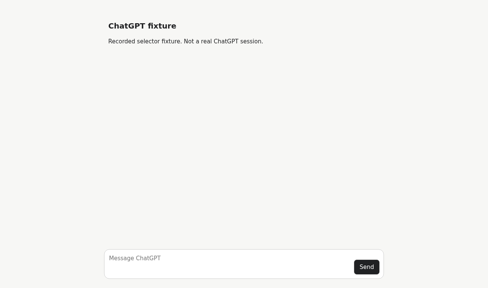 |  | 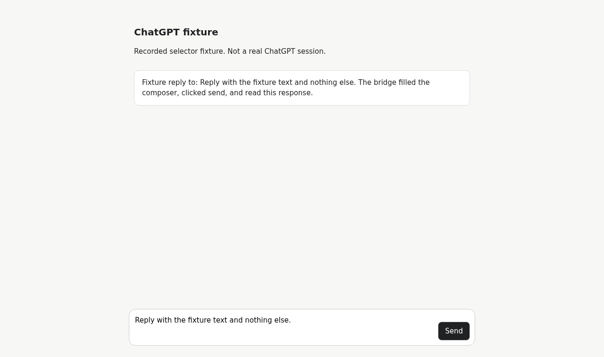 |

### Claude

| Loaded | Running | Done |
| --- | --- | --- |
|  |  | 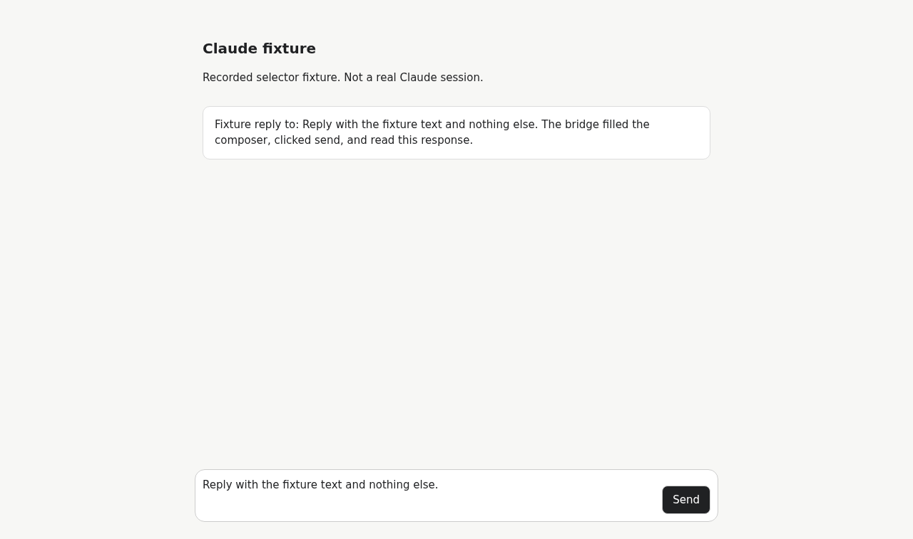 |

### Gemini

| Loaded | Running | Done |
| --- | --- | --- |
| 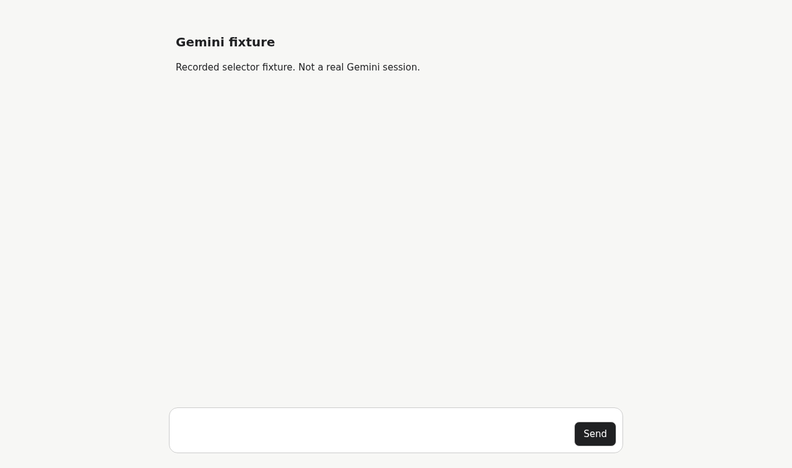 |  |  |

### Mistral

| Loaded | Running | Done |
| --- | --- | --- |
| 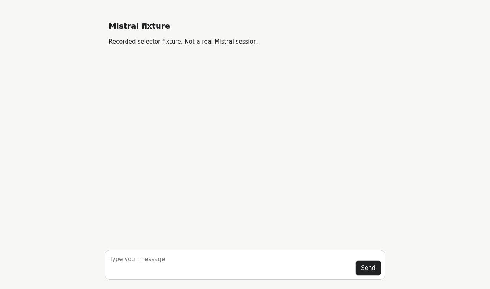 | 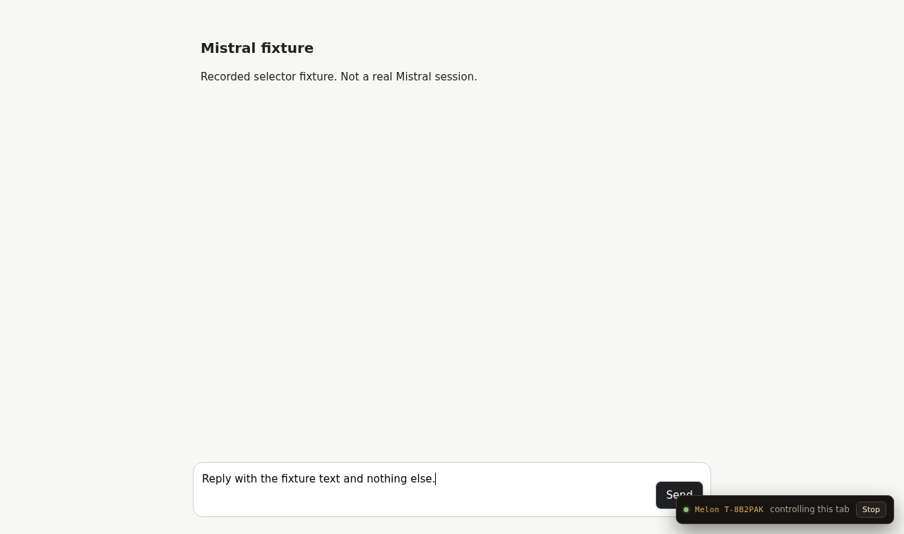 |  |

## Live-tab probe

The live probe opened the real sites in the remote headless Chromium. No
authenticated profile or cookies were available, so every site was blocked
before the bridge could run.

### ChatGPT

| Landing | Classified |
| --- | --- |
|  | 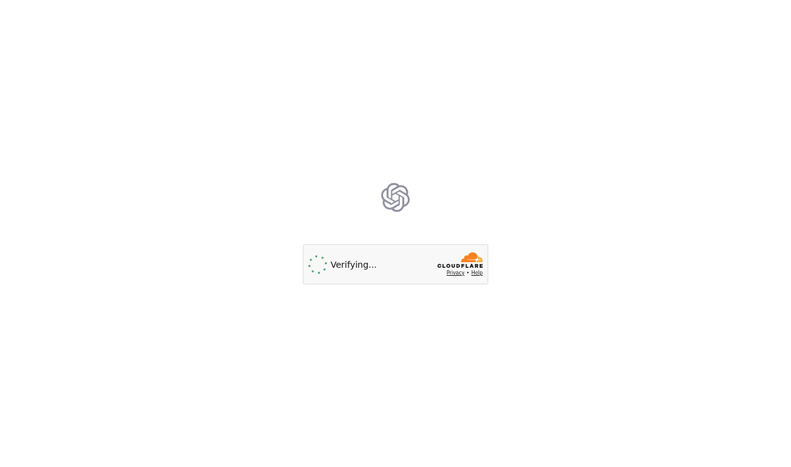 |

### Claude

| Landing | Classified |
| --- | --- |
| _Landing capture timed out while Cloudflare rendered._ | 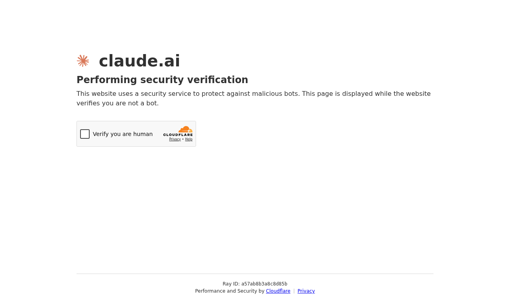 |

### Gemini

| Landing | Classified |
| --- | --- |
| 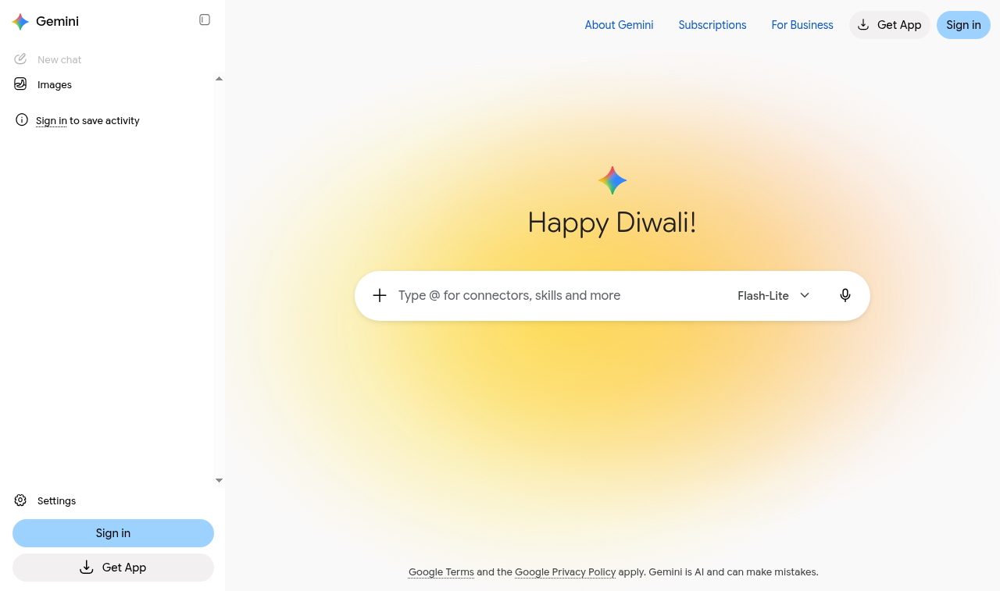 |  |

### Mistral

| Landing | Classified |
| --- | --- |
| 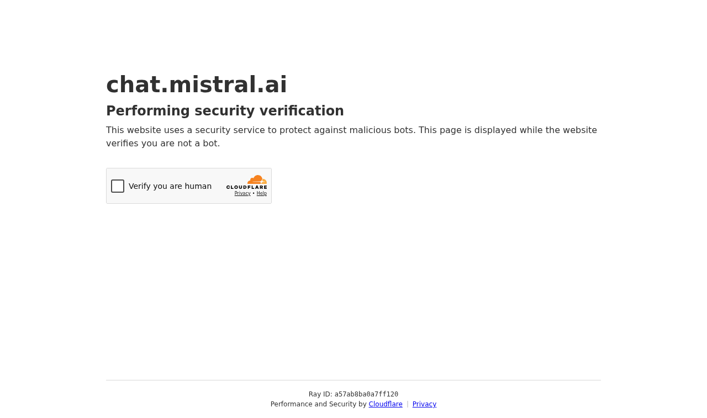 |  |

## Hardware WebGPU probe

The remote runner exposes a software `google/swiftshader` adapter. This does not
satisfy the hardware WebGPU milestone; a machine with a real GPU is still
required.

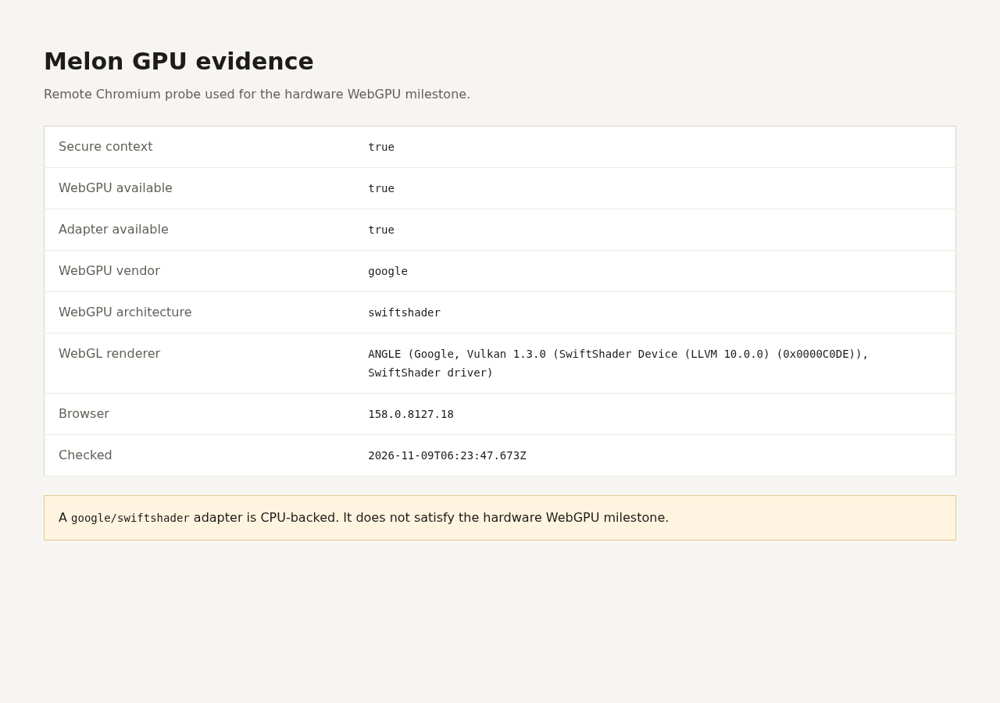

Raw probe output: [`hardware/gpu.json`](hardware/gpu.json).
